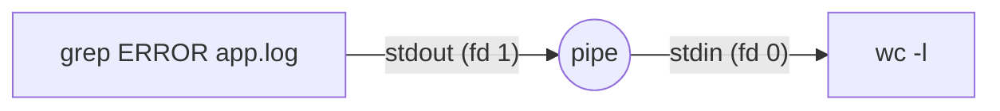

## Objectives

- Write tested Python, run it in an isolated environment, and lint and type-check it.
- Use Git branches, rebase and `git bisect` with confidence.
- Navigate Linux: processes, files, pipes, environment and exit codes.

## Processes, files and pipes

A **program** is a file; a **process** is a running instance with its own address space, process id and table of open file descriptors. Every process starts with three: **0** (stdin), **1** (stdout) and **2** (stderr). A pipe `a | b` connects `a`'s fd 1 to `b`'s fd 0, and `2>&1` points fd 2 at wherever fd 1 points.



The exit code is how a process reports success to its parent: `0` means success and anything else means failure. Tests, CI and shell scripts all rely on it.

## Finding a regression with `git bisect`

`git bisect` binary-searches the commits between a known-good and a known-bad commit. Each step halves the range, so 1,000 commits take about 10 test runs. With a script that exits 0 for "good" and non-zero for "bad", `git bisect run ./check.sh` does the search for you.

## Measuring before optimizing

Run this in the sandbox. It times membership tests on a list and a set of the same size. The list scans every element; the set hashes.

```python run
import time

def time_lookup(container, needle, repeat=200):
    start = time.perf_counter()
    for _ in range(repeat):
        needle in container
    return (time.perf_counter() - start) / repeat

for n in (1_000, 10_000, 100_000):
    data = list(range(n))
    print(n, f"list {time_lookup(data, -1)*1e6:.1f} µs", f"set {time_lookup(set(data), -1)*1e6:.3f} µs")
```

Browser timings are only indicative: Pyodide runs in WebAssembly, so absolute numbers differ from native Python. Week 1's performance experiment is run natively.

## This week's gate

The gate needs **counting evidence**: atlas-lab runs the hidden tests for your CLI log analyzer and bisect lab (atlas-lab arrives in P2), and the retrieval quiz must reach 80%. Practice checks in the browser help you learn but never count.
