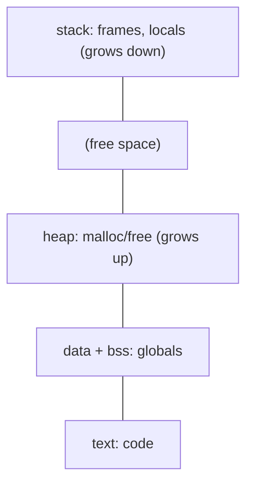

## Objectives

- Explain pointers, stack and heap, and `malloc`/`free`.
- Recognise undefined behaviour and find memory bugs with AddressSanitizer, UBSan and Valgrind.
- Represent integers (two's complement) and floating-point values (IEEE-754).

## Where things live

Locals live in the current **stack frame** and disappear when the function returns, so returning a pointer to one leaves it **dangling**. Heap memory lives until you `free` it. Using it after that is a **use-after-free**, which is undefined behaviour: the program may appear to work, crash, or corrupt data later.

## Tools that find memory bugs

- **AddressSanitizer** (`-fsanitize=address`) instruments every access at compile time and reports out-of-bounds accesses, use-after-free and double free with a stack trace.
- **UBSan** (`-fsanitize=undefined`) reports undefined behaviour such as signed overflow.
- **Valgrind memcheck** runs the unmodified binary on a synthetic CPU. It needs no recompile but is much slower.

## Numbers are bits

A 32-bit signed integer in two's complement ranges from −2³¹ to 2³¹−1. A double has 1 sign bit, 11 exponent bits and 52 fraction bits, so 0.1 is not exact. Compare floats with a tolerance, not `==`.

## This week's gate

Your allocator's test suite must be clean under ASan and UBSan when atlas-lab runs it, and your memory-bug write-up is scored with a rubric. Self-scores are allowed and labelled "self-assessed".
