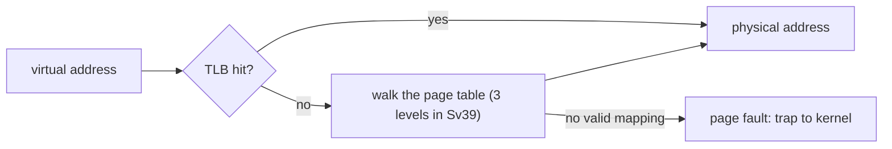

## Objectives

- Explain what a process is and how `fork`, `exec` and `wait` create and manage processes.
- Trace a system call from user mode into the kernel and back.
- Translate a virtual address through a multi-level page table, and say what the TLB caches.
- Describe how a timer interrupt lets the kernel preempt a process and switch to another.

## Processes and system calls

A **process** is a running program with its own address space, registers and open file descriptors. On Unix, `fork()` creates a copy of the calling process: it returns the child's PID in the parent and 0 in the child. `exec()` replaces the current process image (code, data, stack) with a new program, keeping the PID and the open file descriptors (except those marked close-on-exec). The parent collects the child's exit status with `wait()`. A shell is essentially a loop of `fork`, `exec` in the child, and `wait` in the parent.

A **system call** is a controlled entry into the kernel. The program executes a trap instruction (`ecall` on RISC-V, the ISA xv6 uses). The CPU switches to supervisor mode and jumps to the kernel's trap handler, which runs the call and returns to user mode.

## Virtual memory

Each process has its own **page table** mapping virtual pages to physical pages, so the same virtual address can point to different memory in different processes. With 4 KiB pages the low 12 bits of an address are the offset inside the page. RISC-V **Sv39**, used by xv6, has 39-bit virtual addresses and a 3-level table; each level uses 9 bits of the address to index 512 entries. The **TLB** caches recent translations so most accesses skip the walk. An access with no valid mapping, or without permission, raises a **page fault**. The kernel can use faults deliberately: with **copy-on-write** `fork`, parent and child share pages read-only until one of them writes.

## Scheduling

A timer interrupt periodically traps into the kernel. The scheduler can then save the running process's registers (a **context switch**) and resume another, so no process can hold the CPU forever. xv6 uses simple round-robin.

## This week's gate

The xv6 util and syscall lab graders must pass through atlas-lab, and the virtual-memory quiz (server-graded, at least 80%) must pass. The atlas-lab bundle for the xv6 graders is published with the week's lab material; until then the gate page says so. The quiz part can be done now.
