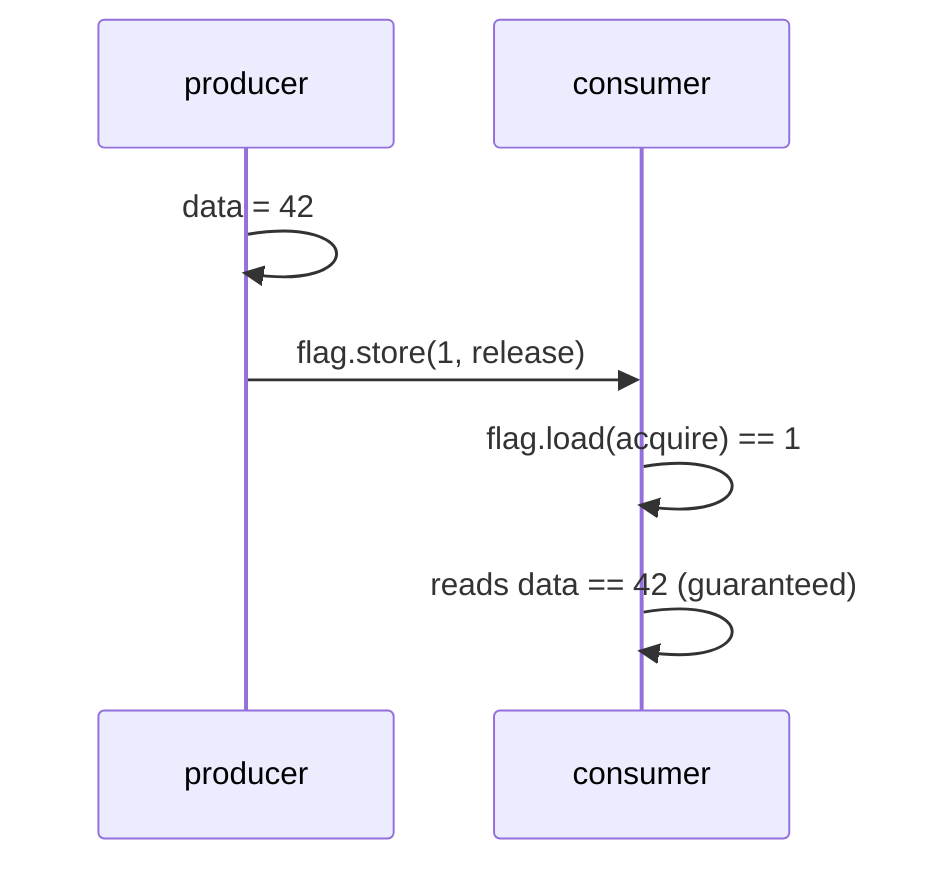

## Objectives

- Find a data race and explain why it is a bug even when tests pass.
- Use mutexes and condition variables correctly, including the "wait in a loop" rule.
- State the four conditions for deadlock and break one of them with lock ordering.
- Explain acquire/release ordering and when sequential consistency is needed.

## Races

Threads in one process share memory. A **data race** is two threads accessing the same location concurrently, at least one writing, with no synchronisation between them. `counter++` is a load, an add and a store, so two threads can both read 5 and both write 6. In C and C++ a data race is undefined behaviour, not just a wrong count.

## Locks and condition variables

A **mutex** makes a critical section run by one thread at a time. A **condition variable** lets a thread sleep until another thread changes shared state. Always wait in a loop that re-checks the condition:

```c
pthread_mutex_lock(&m);
while (!ready)              /* not `if`: wake-ups can be spurious or stale */
    pthread_cond_wait(&cv, &m);
/* ready is true and we hold m */
pthread_mutex_unlock(&m);
```

`pthread_cond_wait` releases the mutex while sleeping and re-acquires it before returning.

## Deadlock

Deadlock needs all four of these: mutual exclusion, hold-and-wait, no preemption, and circular wait. The usual fix is a global **lock order**: if every thread takes lock A before lock B, a cycle cannot form.

## Memory ordering

Compilers and CPUs reorder memory operations that look independent. Atomics carry an ordering. A **release** store publishes every write before it to a thread that reads the value with an **acquire** load. **Sequentially consistent** atomics add a single global order of all such operations; they are the default in C11 and C++ and the easiest to reason about.



**ThreadSanitizer** (`-fsanitize=thread`) tracks happens-before at run time and reports races that actually occur in the run. It cannot prove that no race exists.

## This week's exam

Implement concurrency primitives. Hidden stress tests run under ThreadSanitizer through atlas-lab, and your written memory-ordering justification is scored with the rubric (correctness under contention, ordering, deadlock-freedom, test quality). If you don't pass, the remediation track is the OSTEP concurrency chapters plus three extra drills, and the next attempt uses a new hidden test set.
