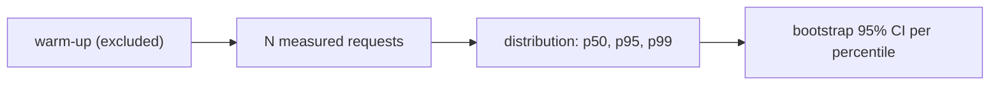

## Objectives

- Build a TCP server with the sockets API and explain blocking versus non-blocking I/O.
- Use `epoll` readiness notification and explain level- versus edge-triggered mode.
- Frame HTTP/1.1 messages correctly (Content-Length, chunked, persistent connections).
- Measure latency honestly: percentiles, warm-up, and confidence intervals.

## Sockets

A TCP server calls `socket`, `bind`, `listen`, then loops on `accept`, which returns a new connected socket per client. With **blocking** I/O, one thread per connection is simple but costly at scale. With **non-blocking** sockets, a call that cannot proceed returns `EAGAIN`, and the program waits for readiness instead.

## epoll

`epoll` lets one thread watch many sockets. In **level-triggered** mode (the default), `epoll_wait` keeps reporting a socket while data remains to be read. In **edge-triggered** mode (`EPOLLET`), it reports only on a change, so you must read until `EAGAIN` or you can stall with data still buffered.

## HTTP/1.1 framing

A message body's length comes from `Content-Length`, or from `Transfer-Encoding: chunked`, which sends sized chunks ending with a zero-length chunk. In HTTP/1.1, connections are persistent by default, so a server must find exactly where one request ends and the next begins. Getting framing wrong is the most common conformance failure.

## Measuring latency

Report the distribution, not an average: p50 shows the typical request, p99 the tail that users of a busy service feel. State the method: tool, request rate, concurrency, warm-up, N and hardware. Beware **coordinated omission**: a load generator that waits for each response before sending the next sends fewer requests exactly when the server is slow, so it under-reports the tail. Prefer a fixed-rate (open-loop) generator. Give each percentile a confidence interval. The lab's analytics page computes bootstrap CIs from your uploaded samples.

## This week's gate

Your server must pass the HTTP conformance tests through atlas-lab, and your latency report is scored for method, percentiles with confidence intervals, and an explanation of the tail.
