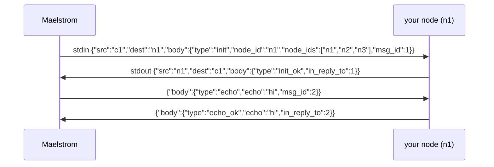

## Objectives

- Write concurrent Go with goroutines, channels, `select` and the `sync` package, and test it with `-race`.
- Implement Maelstrom nodes for Gossip Glomers challenges 1-3: echo, unique IDs, broadcast.
- Solve timed data-structure problems and state their complexity.

## Go concurrency

A **goroutine** is a function running concurrently, scheduled by the Go runtime onto OS threads. An **unbuffered channel** is a rendezvous: a send blocks until a receiver takes the value. A buffered channel blocks only when full. `select` waits on several channel operations at once. Shared maps still need a `sync.Mutex`; a `sync.WaitGroup` waits for a group of goroutines. Run tests with `go test -race`: the race detector is built on ThreadSanitizer.

## Maelstrom and Gossip Glomers

Maelstrom runs your nodes as processes and talks to them with JSON messages: one per line on stdin and stdout, with logs on stderr. It injects faults such as network partitions and checks the history against each challenge's rules.

- **Echo**: reply with the same payload.
- **Unique IDs**: generate globally unique IDs while partitioned, so no coordination is possible. Combine the node ID with a local counter.
- **Broadcast**: gossip values to neighbours until every node has seen every value, efficiently and despite partitions.

## Timed problems

Six timed problems cover hash maps, heaps, BFS/DFS and binary search. Write the complexity before you write code.

## This week's gate

The Maelstrom checks for challenges 1-3 and the timed problems run through atlas-lab.
