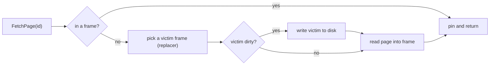

## Objectives

- Explain why databases manage their own memory with a buffer pool instead of relying on the OS page cache.
- Implement a buffer pool manager with pin counts, dirty pages and an eviction policy.
- Compare LRU, LRU-K and CLOCK eviction with concrete access patterns.
- Diagnose a performance problem by forming a hypothesis, measuring with profilers, and verifying the fix with confidence intervals.

## The buffer pool

Data lives on disk in fixed-size **pages**. The **buffer pool** holds a fixed number of in-memory **frames**. A page table maps page IDs to frames. A page in use is **pinned** and cannot be evicted. A **dirty** page must be written back to disk before its frame is reused. Databases manage this themselves because they know their access patterns (scans, index lookups) and their durability rules better than the OS does.

## Eviction policies

- **LRU** evicts the least recently used page. A single large sequential scan can flush every hot page.
- **LRU-K** looks at each page's K-th most recent access (its backward K-distance) and evicts the page where that is oldest. A page with fewer than K accesses counts as infinitely distant, so one-off scan pages leave first.
- **CLOCK** approximates LRU with one reference bit per frame and a sweeping hand.

## Diagnosing a bottleneck

Work in a loop: hypothesis, then measurement, then change, then measure again. Use a sampling profiler such as `perf` for native code or pprof for Go, and read **flame graphs**: width is the share of samples, not the order of calls. Check whether the problem is CPU, lock contention, I/O or memory before changing anything. Report before and after as distributions with bootstrap confidence intervals. "Faster" counts only if the intervals don't overlap in the direction you claim, measured on the same machine.

## Course rules

CMU 15-445 prohibits coding agents on BusTub Projects 1-2 and may ask students not to publish solutions. Systems Atlas follows the same rules: the AI mentor gives no solution code for this week, and you publish write-ups, not BusTub solution code.

## This week's gates

1. BusTub Project 1's local tests pass through atlas-lab, and your eviction-policy trade-offs write-up is scored with the rubric.
2. **Exam**: diagnose a performance bottleneck. The fixed service must meet the stated latency target through atlas-lab, and your diagnosis report needs before/after confidence intervals.
